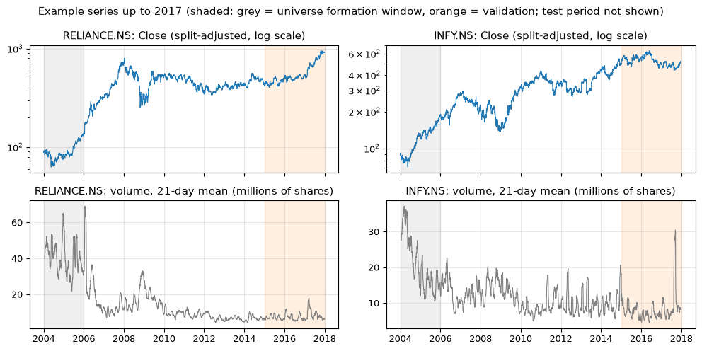
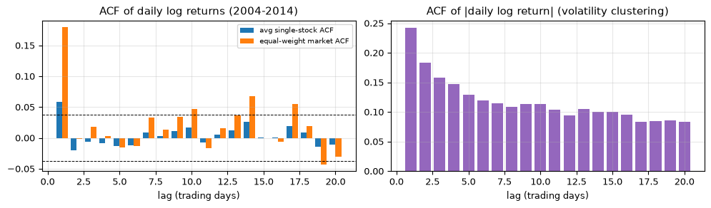
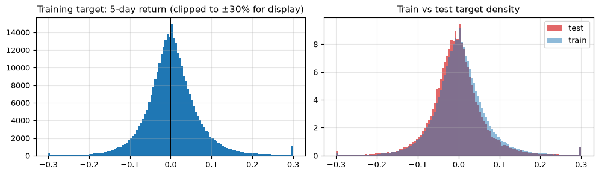
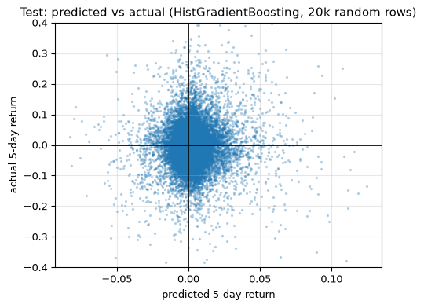
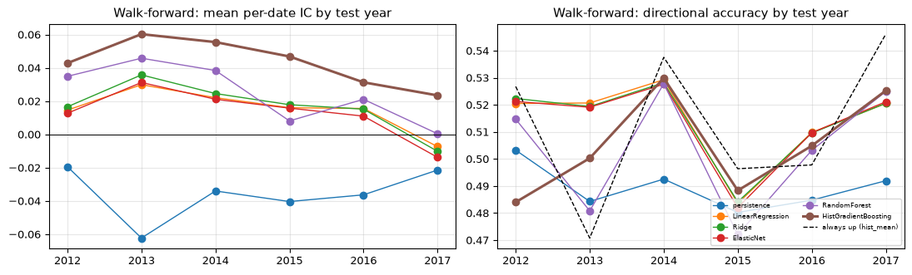
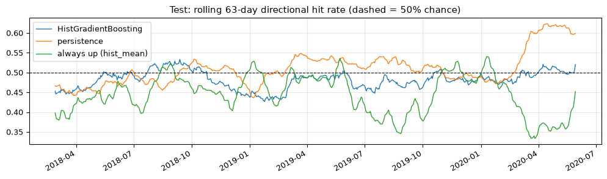
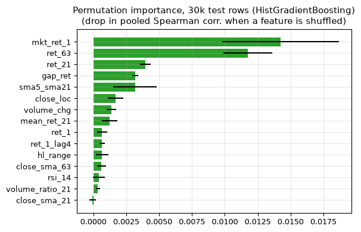
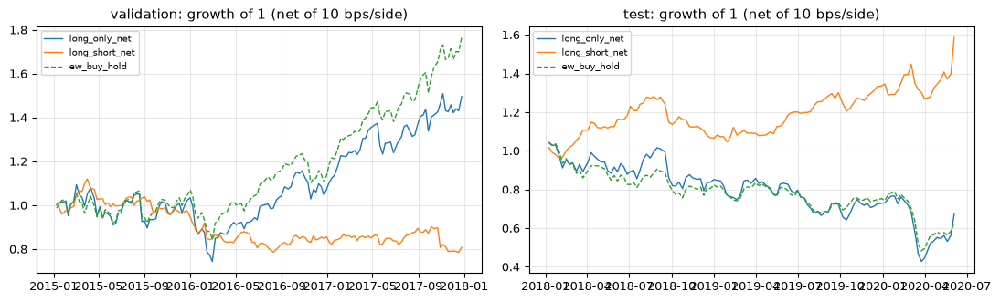

# NiftyQuant

Leakage-controlled experiments on forecasting **5-trading-day forward returns** of 150 liquid NSE-listed
stocks from daily OHLCV data (2004-2020), comparing naive baselines, linear models and tree ensembles with
chronological validation, walk-forward evaluation and a cost-aware backtest.

> **Bottom line (honest null result):** no model forecasts the *size* or *direction* of next week's
> return better than trivial baselines. On validation and test, every learned model has negative R² and none
> beats the best baseline's RMSE. The selected HistGradientBoosting model has a small but persistent ability to
> *rank* stocks against each other on the same date (per-date Spearman IC 0.0434 ± 0.0140 across six
> walk-forward folds, 0.0484 on the 2018-2020 test period). The long-short backtest built on that ranking is
> unstable after costs: it lost money in validation and made money in test.

## Project overview

* One notebook, [`NiftyQuant.ipynb`](NiftyQuant.ipynb), runs top to bottom in a fresh kernel (about 2 minutes on CPU)
  and writes every table and figure in [`artifacts/`](artifacts/).
* Every number in this README is copied from an executed notebook cell or from a CSV that the notebook writes.
* The data is a public Kaggle dataset of Yahoo-Finance-style daily files for NSE and BSE listings. It is **not**
  NIFTY 50 or any other index, and no index-membership claim is made. The project name refers only to the Indian
  market setting.

## Problem definition

For stock *i* and trading day *t*, predict

```
target(i, t) = Close(i, t+h) / Close(i, t) - 1,   h = 5 trading days
```

using only information available at the close of day *t*. Two questions are asked: (1) can the return itself be
forecast (MAE, RMSE, R², direction)? (2) can stocks be **ranked** within a date (per-date IC)? The horizon
h = 5 (one trading week) is justified in notebook Section 6. Daily return autocorrelation is small and confined to the
first lags (average single-stock lag-1 ACF 0.0587, equal-weight market lag-1 ACF 0.1792, 2004-2014), while
absolute returns stay autocorrelated for weeks. A weekly horizon avoids the one-day microstructure/lag-1 effects
and still leaves 441 non-overlapping periods in the 2006-2014 training years (2,207 trading dates). h was fixed before any
model was evaluated.

## Dataset

| item | value |
|---|---|
| Source | Kaggle, [`sagara9595/stock-data`](https://www.kaggle.com/datasets/sagara9595/stock-data) ("Indian stock market data") |
| Version | 1 (downloaded via `kagglehub` into its user cache on 2026-10-08; nothing is stored in this repo) |
| License | CC0-1.0 (Kaggle dataset metadata) |
| Provenance | per the Kaggle description, scraped on 08 June 2020, apparently from Yahoo Finance (`.NS` / `.BO` ticker suffixes, `Adj Close` column) |
| Files | 5,028 CSVs, 1.44 GB: 1,549 `*.NS.csv` (NSE) and 3,479 `*.BO.csv` (BSE, 10 of them numeric BSE scrip codes such as `500084.BO`) |
| Files used | the 1,549 NSE files (443.1 MB) are read and checksummed; 150 of them form the modelling universe. BSE files are only scanned. |
| Checksums | per-file SHA-256 in [`artifacts/data_checksums_nse.csv`](artifacts/data_checksums_nse.csv); combined digest `dd1816320ee495acf36e5823f1bdf3861c806362d31c10b733a9d01d8afa140b` |
| Securities | 1,549 NSE symbols (mostly equities; a few exchange-traded funds such as `GOLDBEES.NS` are present), 1,255 of which also exist as a `.BO` file |
| Date range / frequency | daily trading days, NSE 2000-01-03 .. 2020-06-05 (5,221 distinct dates); BSE same span |
| Columns | `Date, Open, High, Low, Close, Adj Close, Volume`. Prices are in INR per share; volume is presumably shares traded (Yahoo convention, not verified) |
| Size | 4,741,184 NSE rows (524 / 3,263 / 5,063 rows per ticker, min / median / max); 10,833,334 BSE rows |

**Data quality findings (NSE files, notebook Section 4)**

| check | value |
|---|---|
| files total | 5028 |
| NSE files (*.NS.csv) | 1549 |
| BSE files (*.BO.csv) | 3479 |
| BSE files with numeric scrip codes | 10 |
| NSE base symbols also present as .BO | 1255 |
| NSE rows | 4741184 |
| NSE date range | 2000-01-03 .. 2020-06-05 |
| BSE date range | 2000-01-03 .. 2020-06-05 |
| BSE rows | 10833334 |
| NSE distinct dates | 5221 |
| NSE rows on Saturdays/Sundays | 21 |
| NSE rows per ticker (min / median / max) | 524 / 3263 / 5063 |
| NSE tickers with last date >= 2020-06-01 | 1517 |
| NSE all-NaN rows | 314 |
| NSE rows with any NaN | 314 |
| NSE duplicate (ticker, Date) rows | 17 |
| NSE zero-volume rows (share) | 0.0296 |
| NSE non-positive Open/High/Low/Close | 0 |
| NSE non-positive Adj Close rows | 10388 |
| NSE tickers with non-positive Adj Close | 37 |
| NSE rows with Adj Close / Close > 1.001 | 1697 |
| NSE rows with Close outside [Low, High] | 1504 |

**Adjustment.** `Close` is split- and bonus-adjusted: TCS and INFY 1:1 bonus ex-dates show daily `Close` returns
of 0.00039, -0.00911, -0.01131 and 0.02792 instead of about -0.50. `Adj Close` additionally applies a dividend
back-adjustment factor, but that factor is corrupted for part of the data: 10,388 rows (37 tickers) have
non-positive `Adj Close`, 1,697 rows have `Adj Close / Close > 1.001`, the ratio ranges from -68.803 to 190.208, and
ABB's 2002 factor of 0.313 implies dividends far larger than the company paid. The median implied dividend yield
from well-behaved factors is 0.0066 per ticker-year, so ignoring dividends changes a typical 5-day return only
marginally. **Decision: returns and the target use `Close`** (price return, dividends excluded). OHLC share the
same adjustment basis as `Close`, so intraday ratios are consistent.

**Cross-listing.** Most NSE companies also appear as BSE files, which would create near-duplicate series. Only the
NSE (`.NS`) files are used.

## Methodology

1. **Cleaning** (Section 5): drop the 314 all-NaN rows and the remaining duplicate `(ticker, Date)` rows (17 duplicates in
   the raw files), then 140,422 zero-volume rows (non-trading or stale days). Range features use `max(O,H,C)` / `min(O,L,C)` because
   1,504 rows have `Close` outside `[Low, High]`.
2. **Universe, chosen ex ante.** NSE stocks that traded on at least 95% of the 501 trading days of the **formation
   window 2004-01-01 .. 2005-12-31** (480 eligible), ranked by median daily traded value (`Close x Volume`) in that
   window; the top **150** are kept (#150 trades INR 9.9m/day). Modelling samples start on 2006-01-01, so the
   selection uses no data from the training, validation or test periods. This also enforces the minimum-history
   rule (about two years of trading before the first sample). [`artifacts/universe.csv`](artifacts/universe.csv)
   lists the tickers.
3. **Calendar and breaks.** There are 4,040 trading dates (a date counts when at least 50% of the universe traded),
   and 0.0057 of stock-days in the sample are missing. A one-day move with `|ln(C_t/C_{t-1})| > ln(1.5)` (more than
   +50% or less than -33%) is treated as a data break: 42 such breaks occur in 20 tickers, plus 24 resumptions
   after more than 5 missing days. Breaks are neutralised in features, and labels whose window crosses a break
   are dropped. Genuine large moves stay below the threshold; the largest kept move is PNB.NS +0.4620 on 2017-10-25, and INDUSINDBK.NS +0.4467 on 2020-03-26 is also kept.
4. **Features** (29, all trailing, Section 7): lagged daily returns, 5/10/21/63/126-day momentum, rolling mean and
   volatility of returns, close/SMA ratios, `(high-low)/close`, intraday and overnight returns, close location,
   volume change and volume relative to its 21-day mean, RSI(14), and two same-date equal-weight market averages.
5. **Models** trained on winsorised labels (0.5%/99.5% quantiles of the training fold), evaluated on raw labels.

## Feature audit summary

Full table: [`artifacts/feature_audit.csv`](artifacts/feature_audit.csv) (feature, formula, lookback, latest
timestamp used). Every feature uses data up to and including day *t* only. Rolling windows are trailing, with
no centred windows. The only cross-sectional quantities are equal-weighted universe averages from the same date
(`mkt_ret_1`, `mkt_ret_5`), which separate market-wide moves from stock-specific ones. Standardisation and
imputation happen inside scikit-learn pipelines that are fitted on training rows only.

**Programmatic leakage check.** For cutoffs 2010-06-30, 2014-12-31 and 2017-12-29 the features were recomputed
(a) on data truncated at the cutoff and (b) after replacing every row after the cutoff with random noise. All
29 features at dates up to the cutoff were unchanged (maximum absolute difference 0.0e+00 in both cases), and the
notebook asserts this. Other guards: no single feature is a strong proxy for the label (largest |Spearman| with
the target on the training set is 0.0442, `mkt_ret_1`), and a label-shuffle control gives a validation IC of
0.0073 versus 0.0348 with the real labels.

## Validation strategy

| block | prediction dates | rows | last label ends |
|---|---|---|---|
| train | 2006-01-02 .. 2014-12-23 | 326,732 | 2014-12-31 |
| validation | 2015-01-01 .. 2017-12-21 | 108,687 | 2017-12-29 |
| test | 2018-01-01 .. 2020-05-29 | 87,912 | 2020-06-05 |

* **Chronological split by date**, all 150 stocks in every block. The test block is used once, after model selection.
* **Purge / embargo of h = 5 trading days:** the last 5 trading days before every block boundary are removed from
  the earlier block, so every label ends before the next block starts (asserted in the notebook).
* **Expanding-window walk-forward:** six folds with test years 2012 .. 2017. Each fold trains on 2006 .. year-1,
  purged by 5 days, so the folds cover the development period only.
* **Model selection rule (fixed in the configuration before results):** among learned models whose mean per-date
  IC is positive in at least 2/3 of folds and whose walk-forward RMSE is within 1% of the best baseline's, take
  the highest mean walk-forward IC. If no model qualifies, the final model would be the persistence baseline.

## Models evaluated

* **Baselines:** `zero` (0% return), `persistence` (the trailing 5-day return as the forecast), `hist_mean` (mean training-fold target).
* **Linear:** LinearRegression, Ridge (alpha 1000), ElasticNet (alpha 1e-4, l1_ratio 0.5). Each runs as median imputer + StandardScaler + model.
* **Trees:** RandomForest (100 trees, depth 8, min leaf 200, max_features 0.33, max_samples 0.25) and
  HistGradientBoosting (200 iterations, learning rate 0.05, 31 leaves, min leaf 500, L2 1, no early stopping).
* Hyperparameters are fixed and modest; they were **not** tuned on validation or test.
* LightGBM/XGBoost are not used. HistGradientBoosting is already a histogram GBDT of the same family, and the data
  shows no capacity bottleneck (the problem is signal, not model size), so another GBDT would mainly add forking paths.

## Evaluation metrics

MAE, RMSE and R² (`sklearn.r2_score`, relative to the evaluation-period mean) measure point forecasts.
`DirAcc` is the share of non-zero targets whose sign is predicted correctly. Compare it with 50% chance, with
the persistence baseline, and with the "always up" rate that a constant positive forecast (`hist_mean`) attains.
Pearson and Spearman are pooled correlations of prediction vs. actual. **IC** is the Spearman correlation across
stocks computed per date and then averaged. `IC_tstat_no` uses only every 5th date (non-overlapping labels),
because consecutive daily ICs share four of five label days. Selection does **not** use R².

## Final results

**Walk-forward (six yearly folds, 2012-2017; mean ± std across folds)**, from
[`artifacts/walkforward_summary_pretty.csv`](artifacts/walkforward_summary_pretty.csv):

| model | MAE | RMSE | R2 | DirAcc | Spearman | IC_mean | IC>0 folds |
|---|---|---|---|---|---|---|---|
| zero | 0.04010 ± 0.00348 | 0.05714 ± 0.00460 | -0.01105 ± 0.01200 | n/a | n/a | n/a | 0/6 |
| persistence | 0.05839 ± 0.00533 | 0.08071 ± 0.00706 | -1.01541 ± 0.05698 | 0.48951 ± 0.00824 | -0.02379 ± 0.02793 | -0.03561 ± 0.01550 | 0/6 |
| hist_mean | 0.04015 ± 0.00356 | 0.05698 ± 0.00464 | -0.00529 ± 0.00428 | 0.51257 ± 0.02891 | n/a | n/a | 0/6 |
| LinearRegression | 0.04022 ± 0.00347 | 0.05701 ± 0.00453 | -0.00661 ± 0.00802 | 0.51407 ± 0.01616 | 0.03278 ± 0.04651 | 0.01516 ± 0.01242 | 5/6 |
| Ridge | 0.04022 ± 0.00347 | 0.05701 ± 0.00453 | -0.00645 ± 0.00818 | 0.51403 ± 0.01584 | 0.03275 ± 0.04778 | 0.01666 ± 0.01517 | 5/6 |
| ElasticNet | 0.04021 ± 0.00347 | 0.05700 ± 0.00453 | -0.00622 ± 0.00784 | 0.51346 ± 0.01647 | 0.03039 ± 0.04924 | 0.01303 ± 0.01500 | 5/6 |
| RandomForest | 0.04022 ± 0.00356 | 0.05698 ± 0.00455 | -0.00560 ± 0.00470 | 0.50392 ± 0.02315 | 0.01517 ± 0.03712 | 0.02481 ± 0.01797 | 6/6 |
| **HistGradientBoosting (final)** | 0.04067 ± 0.00352 | 0.05744 ± 0.00434 | -0.02241 ± 0.01758 | 0.50544 ± 0.01881 | 0.01765 ± 0.03084 | 0.04338 ± 0.01405 | 6/6 |

All five learned models qualified under the rule. The best baseline walk-forward RMSE is 0.05698, and
HistGradientBoosting's 0.05744 is within the 1% guard. **HistGradientBoosting has the highest mean walk-forward
IC and is positive in 6/6 folds, so it is the final model.** It also has the *lowest* R² of the learned models.
That trade-off is intended: R² is dominated by the market-wide part of weekly returns, which none of these
features predicts, while IC measures the only thing any model here does better than chance, which is ordering
stocks within a date.

**Validation (train 2006-2014 -> validation 2015-2017)**, from [`artifacts/validation_metrics.csv`](artifacts/validation_metrics.csv):

| model | n | MAE | RMSE | R2 | DirAcc | Pearson | Spearman | IC_mean | IC_std | IC_tstat_no |
|---|---|---|---|---|---|---|---|---|---|---|
| zero | 108687 | 0.03861 | 0.05552 | -0.00564 | n/a | n/a | n/a | n/a | n/a | n/a |
| persistence | 108687 | 0.05656 | 0.07867 | -1.01949 | 0.4845 | -0.01472 | -0.03293 | -0.03266 | 0.14165 | -2.65203 |
| hist_mean | 108687 | 0.03865 | 0.05536 | -1e-05 | 0.5158 | n/a | n/a | n/a | n/a | n/a |
| LinearRegression | 108687 | 0.03891 | 0.05562 | -0.00926 | 0.50347 | 0.0022 | -0.00761 | 0.00707 | 0.14132 | 1.24683 |
| Ridge | 108687 | 0.03891 | 0.05562 | -0.00937 | 0.50355 | -0.00072 | -0.00865 | 0.00634 | 0.14035 | 1.27985 |
| ElasticNet | 108687 | 0.03889 | 0.0556 | -0.00883 | 0.50342 | -0.00286 | -0.0115 | 0.00468 | 0.14109 | 1.0874 |
| RandomForest | 108687 | 0.03876 | 0.05544 | -0.00304 | 0.49933 | 0.02159 | 0.00269 | 0.00986 | 0.14011 | 1.22333 |
| **HistGradientBoosting (final)** | 108687 | 0.03913 | 0.05585 | -0.01772 | 0.50662 | 0.02337 | 0.01511 | 0.03483 | 0.13765 | 2.57052 |

**Test (refit on 2006-2017 -> test 2018-01-01 .. 2020-06-05, evaluated once)**, from
[`artifacts/test_metrics.csv`](artifacts/test_metrics.csv):

| model | n | MAE | RMSE | R2 | DirAcc | Pearson | Spearman | IC_mean | IC_std | IC_tstat_no |
|---|---|---|---|---|---|---|---|---|---|---|
| zero | 87912 | 0.04746 | 0.06967 | -0.00308 | n/a | n/a | n/a | n/a | n/a | n/a |
| persistence | 87912 | 0.06525 | 0.09321 | -0.79528 | 0.50913 | 0.08259 | 0.04105 | -0.00797 | 0.15915 | -0.1505 |
| hist_mean | 87912 | 0.04801 | 0.07001 | -0.01286 | 0.44981 | n/a | n/a | n/a | n/a | n/a |
| LinearRegression | 87912 | 0.04782 | 0.06977 | -0.00595 | 0.48442 | 0.05696 | 0.0405 | -0.0036 | 0.15112 | -0.96108 |
| Ridge | 87912 | 0.04779 | 0.06969 | -0.00371 | 0.48501 | 0.06978 | 0.04652 | -0.00197 | 0.14857 | -0.93754 |
| ElasticNet | 87912 | 0.04778 | 0.06968 | -0.00329 | 0.48346 | 0.07271 | 0.04846 | -0.00658 | 0.14758 | -1.22881 |
| RandomForest | 87912 | 0.0479 | 0.06995 | -0.0111 | 0.46955 | 0.03948 | 0.04487 | 0.03415 | 0.13868 | 2.15706 |
| **HistGradientBoosting (final)** | 87912 | 0.04846 | 0.07052 | -0.02763 | 0.48209 | 0.03971 | 0.01685 | 0.04845 | 0.14066 | 3.81596 |

Reading the test table:

* **Point forecasts:** the best RMSE is the `zero` baseline's (0.06967). HistGradientBoosting has RMSE 0.07052 and R² -0.02763.
* **Direction:** the share of positive test-period 5-day returns was 0.4498. HistGradientBoosting's DirAcc of 0.48209 is
  below the 50% coin flip (-0.0179) and below persistence's 0.50913 (-0.0270). It is above the always-up rate
  (+0.0323) only because the test period fell more often than it rose.
* **Ranking:** test IC 0.04845 (non-overlapping t-stat 3.82). By year: 0.0478 (2018), 0.0387 (2019), 0.0735 (2020).
  Mean test returns rise almost monotonically across within-date prediction deciles, from -0.01011 for decile 1 to
  -0.00053 for decile 9 and -0.00106 for decile 10 ([`artifacts/test_deciles.csv`](artifacts/test_deciles.csv)).
* **Reversal reference:** the plain short-term reversal rule (`-ret_5`) has IC 0.0356 in walk-forward, 0.0327 in validation and
  0.0080 in test. During model selection the reversal effect explains most of the model's IC; on the test period it does not.
* **Permutation importance** on 30k test rows ([`artifacts/feature_importance.csv`](artifacts/feature_importance.csv))
  is led by `mkt_ret_1` and `ret_63`. Several features (for example `mkt_ret_5`, `ret_10`, `ret_5`) have *negative*
  importance, i.e. on test data the model's use of them hurts, a sign of regime dependence.

**Backtest (optional, included).** Signal at close *t*, execution at close *t+1*, 5-day non-overlapping holds,
equal weight in the top 20% of predictions (long-only), plus a short leg in the bottom 20% for the long-short
variant. Costs are 10 bps per side on traded notional; turnover is the sum of |weight changes| after drift per
rebalance. The tradable set at *t* is every stock with complete features at *t*, so it does not depend on future
prices. The benchmark is an equal-weight buy-and-hold of the universe. Prices exclude dividends throughout, and no
borrow costs are modelled. Full validation and test periods are reported, with no sub-period selection
([`artifacts/backtest_summary.csv`](artifacts/backtest_summary.csv)):

| portfolio | period | periods | total_return | ann_return | ann_vol | sharpe_rf0 | max_drawdown | avg_turnover | avg_cost_per_period |
|---|---|---|---|---|---|---|---|---|---|
| long_only_net | validation | 147.0 | 0.4956 | 0.148 | 0.2486 | 0.6806 | -0.3199 | 1.4435 | 0.0014 |
| long_only_gross | validation | 147.0 | 0.8478 | 0.2343 | 0.2487 | 0.9726 | -0.2727 | 1.4435 | 0.0 |
| long_short_net | validation | 147.0 | -0.1925 | -0.0707 | 0.1492 | -0.4155 | -0.2989 | 2.8707 | 0.0029 |
| long_short_gross | validation | 147.0 | 0.2319 | 0.0741 | 0.1487 | 0.5561 | -0.1444 | 2.8707 | 0.0 |
| ew_buy_hold | validation | 147.0 | 0.765 | 0.2151 | 0.2061 | 1.0505 | -0.2115 | n/a | 0.0 |
| long_only_net | test | 118.0 | -0.328 | -0.1561 | 0.3556 | -0.2989 | -0.5897 | 1.2827 | 0.0013 |
| long_only_gross | test | 118.0 | -0.2174 | -0.0994 | 0.3552 | -0.1172 | -0.5341 | 1.2827 | 0.0 |
| long_short_net | test | 118.0 | 0.5862 | 0.2178 | 0.1715 | 1.2351 | -0.1824 | 2.7038 | 0.0027 |
| long_short_gross | test | 118.0 | 1.1794 | 0.3948 | 0.1709 | 2.0372 | -0.1356 | 2.7038 | 0.0 |
| ew_buy_hold | test | 118.0 | -0.3692 | -0.1787 | 0.2626 | -0.6146 | -0.5354 | n/a | 0.0 |

The long-short spread is positive gross in both periods, but costs of about 0.27-0.29% per 5-day rebalance (turnover about 2.7-2.9)
turn validation negative. Net long-short was negative in every validation year and positive in every test year
(Section 13 output), so the sign depends on the regime. The long-only portfolio trailed the equal-weight benchmark
in validation (total return 0.4956 vs 0.7650) and lost slightly less than it in test (-0.3280 vs -0.3692). **This is not evidence of a tradable edge.**

## Key visualizations

| | |
|---|---|
|  |  |
| Example price/volume series up to 2017 | Return and absolute-return autocorrelation (horizon choice) |
|  |  |
| 5-day target distribution, train vs test | Test predictions vs outcomes |
|  |  |
| Walk-forward IC and directional accuracy per fold | Rolling 63-day hit rate on the test period |
|  |  |
| Permutation importance (test sample) | Backtest equity curves, net of costs |

## How to run

```bash
git clone https://github.com/obstinix/NiftyQuant.git
cd NiftyQuant
python -m venv .venv && source .venv/bin/activate      # Windows: .venv\Scripts\activate
pip install -r requirements.txt
# Kaggle credentials are needed for the first download only: ~/.kaggle/kaggle.json or KAGGLE_USERNAME / KAGGLE_KEY
python -m jupyter nbconvert --to notebook --execute --inplace --ExecutePreprocessor.timeout=3600 NiftyQuant.ipynb
```

The dataset (about 1.4 GB) is downloaded by `kagglehub.dataset_download("sagara9595/stock-data")` into the
kagglehub cache (default `~/.cache/kagglehub`), outside the repository. To check you have the same data, compare
the combined SHA-256 printed in Section 3 with the one above.

## Dependencies and versions

See [`requirements.txt`](requirements.txt). The committed run used:

| package | version |
|---|---|
| python | 3.11.9 |
| numpy | 2.4.6 |
| pandas | 3.0.6 |
| scikit-learn | 1.9.1 |
| scipy | 1.17.1 |
| matplotlib | 3.11.2 |
| kagglehub | 1.0.2 |

## Reproducibility

* **Seeds:** `SEED = 42` is set once in the configuration cell. It is passed explicitly to Ridge, ElasticNet,
  RandomForest and HistGradientBoosting, to every row sampler, to the label-shuffle control and to permutation
  importance. Splits are deterministic by date.
* **Determinism:** two consecutive fresh runs produced identical metric tables. Only the `fit_s` timing column differs.
* **Hardware used:** Intel(R) Core(TM) Ultra 9 275HX, 24 logical CPUs, Windows-10-10.0.26300-SP0; GPU detected: NVIDIA GeForce RTX 5070 Laptop GPU (used: False) (the OS is Windows 11; Python's `platform` string reports it as Windows-10). The GPU is detected and logged but **not used**: all estimators are scikit-learn,
  CPU-only, so CPU results are the reported results.
* **Runtime:** 2.2 minutes end to end for the committed run, including data loading and checksums.
* **Artifacts:** [`artifacts/run_info.csv`](artifacts/run_info.csv) records the environment, runtime, final model and data digest.

## Limitations

* **Survivorship bias.** The files were scraped in June 2020; 1,517 of 1,549 NSE tickers have data up to
  2020-06-01 or later, so companies that delisted earlier are largely missing. Choosing the universe ex ante in
  2004-2005 cannot fix this, because stocks that failed after 2005 are probably absent from the source. Long-only
  results are likely optimistic.
* **Price returns only.** Dividends are excluded because `Adj Close` is corrupted for part of the data. The median
  implied yield is small but not zero.
* **Data quality.** This is a single unofficial source with residual bad ticks and unadjusted corporate actions. The
  ln(1.5) break rule is a heuristic, and dropping labels that cross a break uses future information *for label
  validity only* (42 breaks; the backtest does not apply this filter). Volume split-adjustment was not verified.
* **One test window** (2018-01 .. 2020-06), dominated by a falling market and the COVID-19 crash. Ranking skill
  in one window of about two and a half years is weak evidence.
* **Fixed hyperparameters, no tuning**, and a modest universe of 150 large and mid caps chosen by 2004-2005
  liquidity. Results may not carry over to other universes, horizons or periods.
* **Overlapping labels:** daily samples with 5-day labels are autocorrelated, so pooled metrics overstate the
  effective sample size; `IC_tstat_no` is the more honest significance figure.
* **Backtest simplifications:** execution at the close with no market impact, no borrow cost or short-sale
  constraints, and a flat 10 bps per side.

## Disclaimer

These are experiments on historical market data for research purposes. They are **not financial advice**, they do
not guarantee future returns, and no claim of profitability is made. Past patterns in this dataset may not persist.
